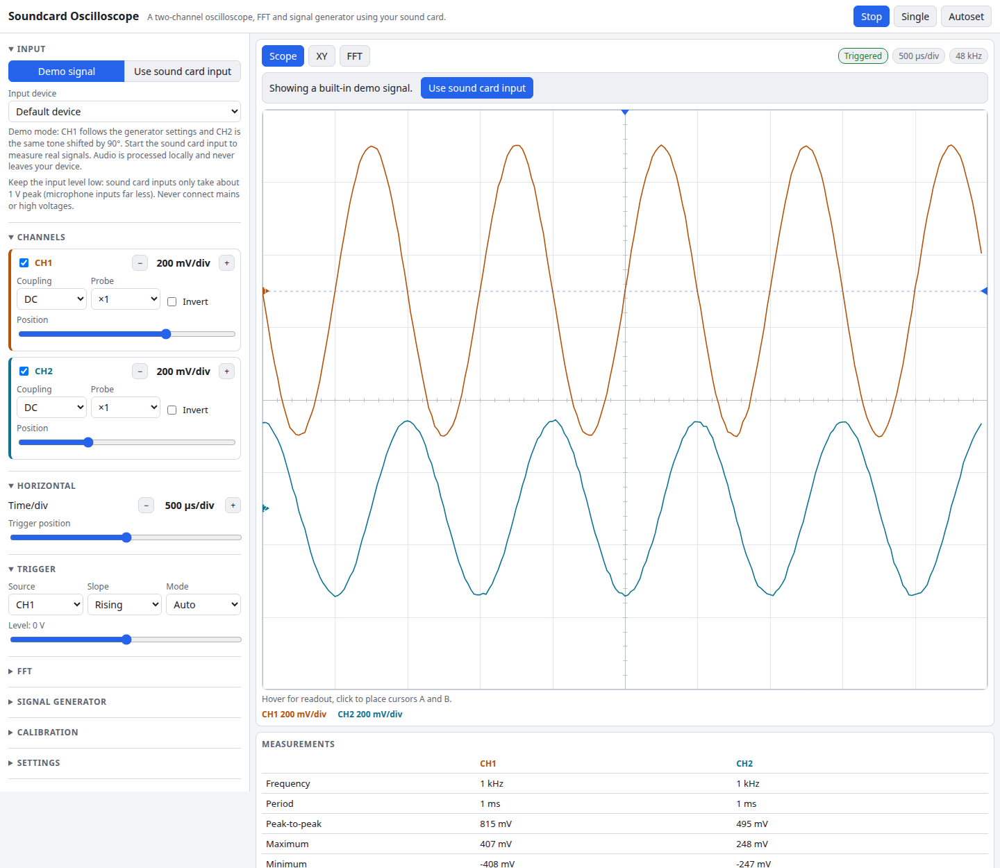

# Soundcard Oscilloscope

A two-channel oscilloscope that runs on your computer's sound card, right in the browser. Plug a signal into the line-in or microphone jack and get edge triggering, timebase and volts/div controls, an XY (Lissajous) display, an FFT spectrum, automatic measurements, a built-in signal generator and calibration. It opens with a demo signal, so you can try every control before connecting anything.

**Try it: [hermes98761234.github.io/soundcard-oscilloscope](https://hermes98761234.github.io/soundcard-oscilloscope/)**

[](https://github.com/hermes98761234/soundcard-oscilloscope/actions/workflows/deploy.yml)



## Features

- **Two channels** from a stereo input, each with volts/div, vertical position, DC/AC coupling, invert and ×1/×10/×100 probe factor.
- **Triggering:** rising or falling edge on CH1 or CH2, adjustable level and horizontal position, Auto and Normal modes, Single shot, Run/Stop. Triggers are interpolated to sub-sample precision, so periodic signals hold still even at 20 µs/div.
- **Timebase** from 20 µs/div to 500 ms/div, with min/max decimation for long records and sample dots when zoomed far in.
- **XY mode** for Lissajous figures and phase comparison.
- **FFT view** with Rectangular, Hann, Hamming, Blackman and Flat-top windows, 1k to 32k points, log or linear frequency axis, dBV or volts, averaging, peak marker with parabolic interpolation, and THD.
- **Measurements:** frequency, period, Vpp, max, min, mean, RMS (total and AC), duty cycle and the phase between channels. A clipping warning shows when the input reaches full scale.
- **Cursors** (click twice for A and B) with Δt, 1/Δt and ΔV, plus a hover readout.
- **Signal generator** (sine, square, triangle, sawtooth, white noise) on the left, right or both outputs, via Web Audio.
- **Calibration:** feed in a known amplitude, enter it, and the full-scale voltage is set for you. There is also a zero-offset button.
- **Autoset** picks volts/div, timebase and trigger level from the measured signal.
- English and Ukrainian, light/dark/system theme, and all settings remembered in the browser. Works on desktop and phones.
- **Private by design:** no server, no tracking. Audio is processed in your browser and never leaves the device.

## How it works

Samples come from `getUserMedia` (with echo cancellation, noise suppression and auto gain turned off) into an `AudioWorklet`, which hands 1024-sample blocks to the page. Each channel is kept in a ring buffer holding 8 seconds of history, addressed by absolute sample number.

On every frame the scope searches the recent history for the newest trigger event that has the pre-trigger samples before it and the rest of a 10-division window after it. The trigger is a Schmitt-style crossing with hysteresis, located by linear interpolation. The sub-sample position shifts the drawn trace so repeated captures line up. Auto mode falls back to a free-running window if nothing triggers for 100 ms. Stopping freezes the history, so you can still change the timebase and re-trigger.

Voltages are `raw × full-scale volts × probe + offset`. Sound cards are AC-coupled and have no absolute reference, so use the Calibration panel for real volts. Measurements use at least the last 0.25 s so low frequencies are measured properly, even at fast timebases. Frequency comes from averaged mid-level rising crossings. The FFT is a radix-2 transform, normalised so a sine of peak amplitude A reads A in its bin.

The signal logic lives in `src/lib/` as pure functions with unit tests: FFT and windows against textbook coherent gains, measurements on known sines, square and pulse waves, THD (including the 48 % of a square wave), and trigger placement.

## Tips and limits

- Sound card inputs take about 1 V peak. Use a divider or a ×10 probe for more, and never connect mains.
- The bandwidth is half the sample rate (usually 24 kHz) and the input is AC-coupled, so DC and very slow signals cannot be seen. Many cards also have a high-pass filter around 10 to 20 Hz.
- Browsers can only expose what the device offers. A mono microphone gives CH1 only, and CH2 stays flat.
- The microphone needs HTTPS or localhost, and the browser will ask for permission.

## Quick start

You need [Node.js](https://nodejs.org/) 22.

```bash
git clone https://github.com/hermes98761234/soundcard-oscilloscope.git
cd soundcard-oscilloscope
npm install
npm run dev       # http://localhost:5173
npm test          # DSP, trigger, calibration and i18n tests
npm run build     # static site in dist/
```

## License

MIT
